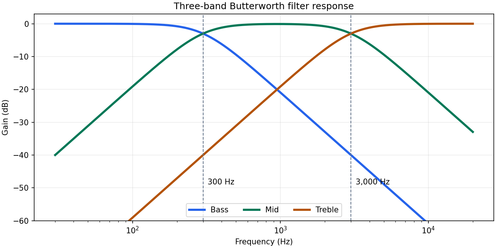

# Three-Band Audio Filter Demo

An executable signal-processing companion to my three-band audio hardware project. In the hardware project I designed and built a Butterworth equalizer, developed an 80 kHz PWM Class D amplifier, and integrated an OLED for audio-band visualization.



**What to look for.** The bass path passes low frequencies, the mid path passes the range between the two crossovers, and the treble path passes high frequencies. These curves are calculated from the demo’s filter equations.

This standalone simulation shows what the equalizer's filter paths do to three input tones. It evaluates second-order Butterworth low- and high-pass responses, with a high-pass and low-pass in series for the mid band. The example uses illustrative 300 Hz and 3 kHz crossover frequencies. Its output is calculated attenuation in dB. It does not model the amplifier or claim measured hardware performance.

The Python simulation was prepared with AI assistance as a companion to the original hardware project.

Run with Python 3.10 or later. The check verifies the nominal cutoff and that each example tone is strongest in its intended band.

```sh
python filter_response.py
python filter_response.py --check
```
